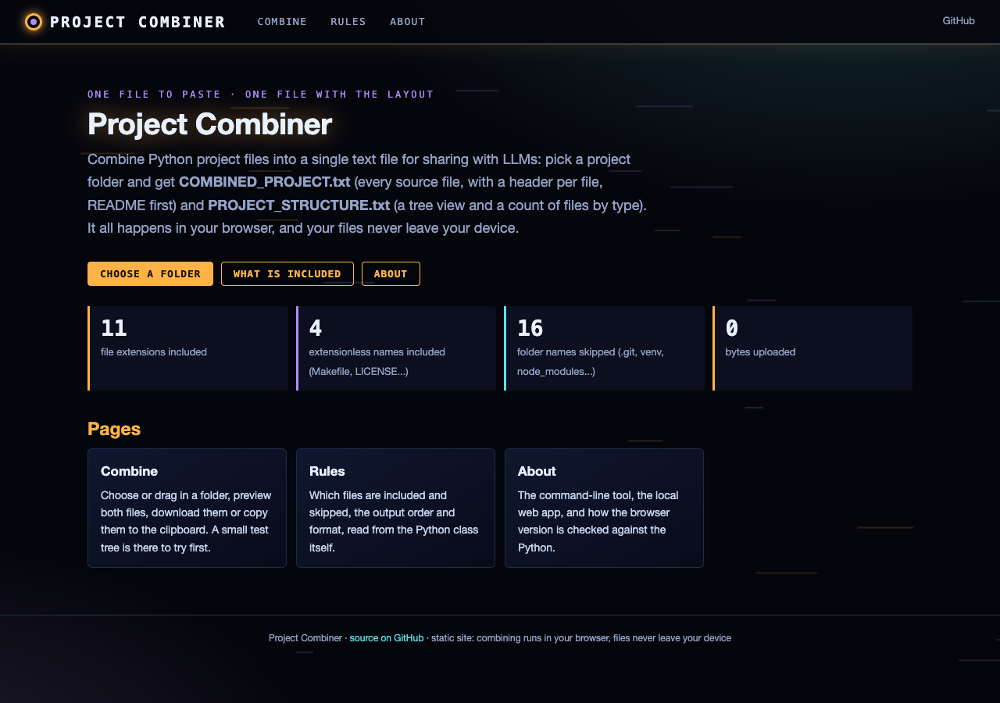
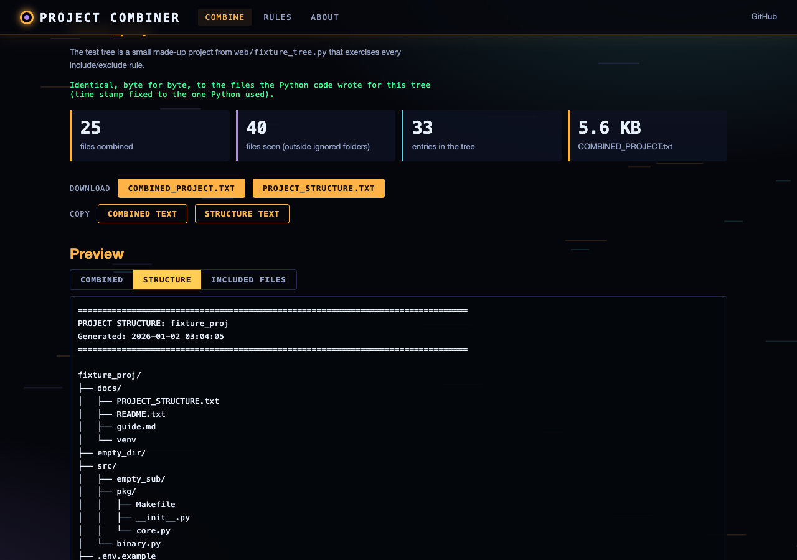
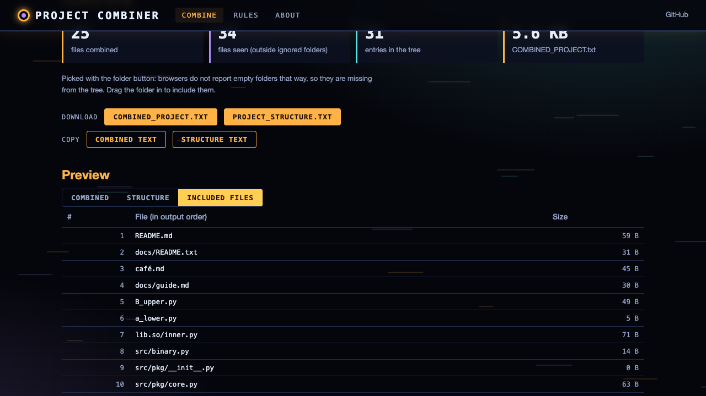
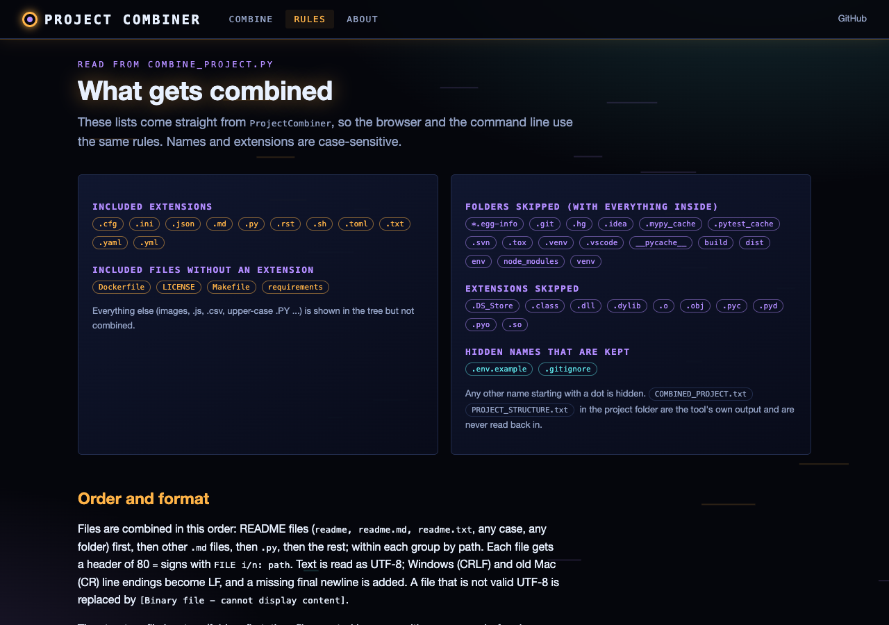

# Project Combiner

A utility that combines all files in a Python project into a single text file for easy sharing (e.g., pasting into an LLM chat). Also generates a tree-view project structure file.

## Features

- **File combination** -- merges all project source files into one `COMBINED_PROJECT.txt`
- **Structure generation** -- creates a `PROJECT_STRUCTURE.txt` with tree view and file statistics
- **Smart filtering**:
  - Includes: `.py`, `.md`, `.txt`, `.yml`, `.yaml`, `.json`, `.toml`, `.cfg`, `.ini`, `.rst`, `.sh`
  - Excludes: `__pycache__`, `.git`, `node_modules`, `venv`, binary files, hidden files
- **Sorted output** -- documentation files first, then Python files, then others
- **CLI interface** with configurable project root and output directory

## Requirements

- Python 3.6+ (no external dependencies)

## Usage

```bash
# Combine current directory
python combine_project.py

# Combine a specific project
python combine_project.py /path/to/project

# Specify output directory
python combine_project.py /path/to/project --output ./combined_output
```

### Output Files

| File | Contents |
|------|----------|
| `COMBINED_PROJECT.txt` | All source files concatenated with headers |
| `PROJECT_STRUCTURE.txt` | Tree view + file count summary |

## Example Output

```
================================================================================
COMBINED PROJECT: my_project
Generated: 2026-04-07 10:00:00
Total files: 12
================================================================================

================================================================================
FILE 1/12: README.md
================================================================================

# My Project
...
```

## Web version (runs in your browser)

**https://gddickinson.github.io/combine_project/** is the same tool as a web page: choose a project folder (or drag it
in) and download or copy `COMBINED_PROJECT.txt` and `PROJECT_STRUCTURE.txt`. The files are read by the browser only:
nothing is uploaded. `web/static/combine_engine.js` is a port of `ProjectCombiner` with the same include/exclude rules
(taken from the Python class at build time), order and formatting; node tests require its output to equal the Python
output **byte for byte** on a test tree that exercises every rule (`web/fixture_tree.py`; CRLF/CR line endings, a BOM,
non-UTF-8 `.py`, hidden and ignored folders, Unicode names, a stale output file). The "Try the test tree" button
repeats that check live. Browser limits: no symbolic links, and empty folders only appear when the folder is dragged in.

### Run the web app

```bash
pip install -r requirements-web.txt   # Python 3.11+ for the web app; the CLI itself has no dependencies
python run_web.py                     # http://127.0.0.1:8151 (local only)
```

Pages: **Combine** (pick/drop a folder, preview, download, copy), **Rules** (what is included and skipped, read from
`ProjectCombiner`), **About**.

### Static site (GitHub Pages)

`python scripts/build_static.py --out site` exports the front end and the API answers (rules, test tree with its
Python output); `.github/workflows/pages.yml` publishes it on every push to main (Settings → Pages → Source: GitHub
Actions).

Tests: `python -m pytest -q` (CLI tests, API, static build, fixture is current, node tests of the JS port);
regenerate the fixture with `python scripts/make_combine_fixture.py`; smoke test and screenshots:
`python scripts/screenshots.py --static "" combine rules about`.






## Project Structure

```
combine_project/
├── combine_project.py   # ProjectCombiner class + CLI entry point
└── README.md
```


---
*Built with AI assistance from [Claude (Anthropic)](https://claude.com/).*
